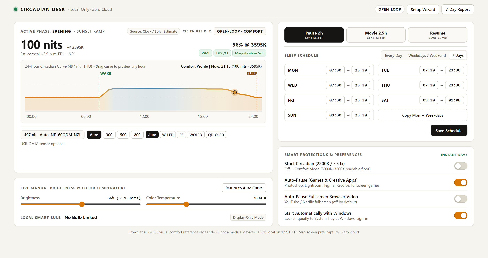
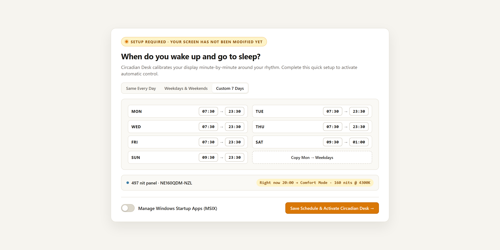
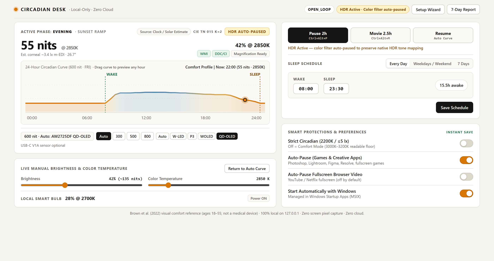
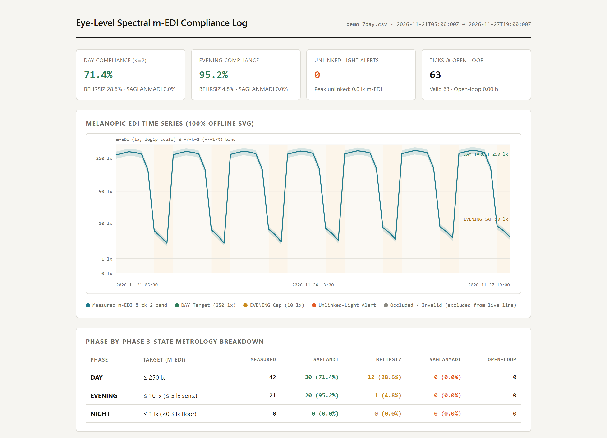

<div align="center">

# Circadian Desk

**Local-First Windows 10/11 Display & Smart-Light Orchestrator**

*Zero cloud · Zero telemetry · Zero admin privileges · Pure Python standard library*

[](https://github.com/cagriaksoy191-oss/circadian-desk/releases)
[](#quick-start)
[](LICENSE)
[](#permissions-win32-apis--network-declaration)

[Live Simulator & Website](https://cagriaksoy191-oss.github.io/circadian-desk/) &middot; [Quick Start](#quick-start) &middot; [Features](#what-makes-circadian-desk-different) &middot; [Permissions & Privacy](#permissions-win32-apis--network-declaration) &middot; [Smart Bulbs & Reports](#optional-local-smart-bulbs--7-day-reports) &middot; [Roadmap](ROADMAP.md)

</div>

---

**Circadian Desk** synchronizes your laptop/monitor hardware backlight and GPU color temperature — plus optional local LAN smart lamps (**Philips Hue**, **WiZ**, **Home Assistant MQTT**) — along a smooth, MIRED-continuous circadian curve calibrated to **CIE S 026** and **Brown et al. (2022)** visual-comfort targets.

Unlike legacy blue-light filters, it requires **no Registry edits, no reboot, no admin rights, and no cloud account**, leaves your screen untouched until you complete first-run setup, automatically pauses for **Windows HDR**, fullscreen games, and creative apps (**Photoshop, Lightroom, Figma, DaVinci Resolve**), and protects **OLED / QD-OLED** panels with a `>= 42 nit` hardware floor and `0.0` black-level offset.



<table>
  <tr>
    <td width="50%" valign="top">
      
      <br />
      <sub><strong>Untouched First-Run Setup Gate:</strong> Display stays completely unmodified until you confirm your wake/sleep rhythm (Every Day, Weekdays/Weekends, or Custom 7 Days).</sub>
    </td>
    <td width="50%" valign="top">
      
      <br />
      <sub><strong>Windows 11 HDR Auto-Pause &amp; QD-OLED Compensation:</strong> Automatically releases the color matrix when HDR turns ON and coordinates optional local Philips Hue / WiZ bulbs.</sub>
    </td>
  </tr>
</table>

---

## Quick Start

### Option 1 — Portable Windows App (Zero Python Required)
1. Download **`CircadianDesk-v1.0.0-win64-portable.zip`** from [GitHub Releases](https://github.com/cagriaksoy191-oss/circadian-desk/releases/latest).
2. *(Optional, recommended)* Verify integrity against `SHA256SUMS.txt` or GitHub SLSA build provenance:
   ```powershell
   Get-FileHash .\CircadianDesk-v1.0.0-win64-portable.zip -Algorithm SHA256
   gh attestation verify .\CircadianDesk-v1.0.0-win64-portable.zip -R cagriaksoy191-oss/circadian-desk
   ```
3. Extract the **`CircadianDesk\`** folder anywhere on your PC (keep `_internal\` alongside `CircadianDesk.exe`).
4. Double-click **`CircadianDesk.exe`**:
   - The local offline Control Panel opens automatically at `http://127.0.0.1:8765`, and a System Tray icon appears in your taskbar.
   - Your display is **not touched** until you confirm your wake/sleep schedule and click **Save Schedule & Activate Circadian Desk**.

> **SmartScreen Note:** Portable GitHub builds are compiled transparently via public GitHub Actions (official PSF-signed CPython, `--onedir --noupx`) and are currently unsigned while [SignPath Foundation](CODE_SIGNING_POLICY.md) OSS signing and **Microsoft Store (`$0` MSIX)** certification are pending. On first launch, Windows Defender SmartScreen may display *"Unknown publisher"* — click **More info → Run anyway**, verify `SHA256SUMS.txt`, or inspect/run directly from Python source below.

### Option 2 — Scoop Package Manager (Available Now)
```powershell
scoop bucket add circadiandesk https://github.com/cagriaksoy191-oss/scoop-circadiandesk
scoop install circadiandesk
```

### Option 3 — Microsoft Store (`$0` MSIX · Zero SmartScreen) *(Certification Pending)*
Once Microsoft Store certification publishes, Circadian Desk will be Microsoft-signed with zero SmartScreen/Smart App Control prompts, native Windows Startup Apps integration, and one-command WinGet install:
```powershell
winget install <StoreProductID> --source msstore
```
*(MSIX build & Partner Center certification guide: [`prototype/packaging/msix/README_MSIX.md`](prototype/packaging/msix/README_MSIX.md).)*

### Option 4 — Run Directly from Source (Python 3.10+, Zero Runtime `pip` Dependencies)
Circadian Desk's entire desktop runtime uses **only the Python standard library** — no `pip install` needed to run:
```powershell
git clone https://github.com/cagriaksoy191-oss/circadian-desk.git
cd circadian-desk\prototype

# Launch the offline Control Panel (http://127.0.0.1:8765) + System Tray + HDR/Game Auto-Pause:
python -m orchestrator.daemon --config --open-loop --monitor --web-ui --tray --auto-pause --open-browser

# Verify CLI version fast-path:
python -m orchestrator.daemon --version
```

---

## Everyday Controls & Shortcuts

| Control | Action |
|---|---|
| **Drag 24h Curve (Scrubber)** | Drag pointer horizontally across the 24-hour curve to live-preview any hour on your monitor; smoothly snaps back `1.5s` after release |
| **`Ctrl + Alt + P`** | Pause circadian filtering for **2 hours** (instant full-color restore) |
| **`Ctrl + Alt + M`** | **Movie Mode** — `3400K` balanced cinema warmth for **2.5 hours** |
| **System Tray Hover** | Live instrument readout (`Circadian Desk — 3595K · 100 nit · Comfort`) with zero global hooks |
| **System Tray → Quit** | Cleanly restores your exact original Windows brightness and color matrix before exit |
| **Settings Storage** | Cleanly stored under `%LOCALAPPDATA%\CircadianDesk\` (`config.json`, `app.log`) |

---

## What Makes Circadian Desk Different

### 1. Physically Calibrated Photobiology (Not a Flat Linear Kelvin Slider)
- **MIRED-Space Transitions & von Kries Rate Limiting:** Color temperature interpolates in reciprocal megakelvin (`10^6 / K`) so visual warmth changes feel perceptually uniform from `5800K` down to `2200K`, paired with an 8-second gentle first-evening activation glide.
- **No Double-Dimming (`Y_lut` Compensation):** Warm GPU color matrices cut effective white luminance by 35–57%. Circadian Desk compensates `Y_lut(CCT, panel)` inside backlight mapping so warming your screen doesn't unexpectedly make it half as bright as intended.
- **Panel Spectrum & OLED Protection:** Auto-detects monitor peak brightness (`EDID CTA-861.3`), physical screen size (`Ω_proj`), and CIE 1931 gamut. Supports **`W-LED IPS`**, **`DCI-P3 IPS`** (`-150K`), **`WOLED`**, and **`QD-OLED`** (`-350K`, compensating QD-OLED's +44–66% evening `m-DER`), while enforcing a **`>= 42 nit` OLED hardware floor** (avoiding near-black crush & deep PWM) and a **`0.0` black offset** (true OLED `#000000` pixels stay off).
- **Readable Default Comfort Mode:** Evening comfort floor settles cleanly around `3000K–3200K @ 50–55 nits` (incorporating Windows Dark/Light Mode `APL_eff`), with 1-click **Strict Circadian (`2200K / <= 5 lx`)** mode whenever desired.

### 2. Built for Windows 11 `24H2 / 25H2 / 26H2`
- **Automatic Windows HDR Auto-Pause:** Queries `DisplayConfigGetDeviceInfo (GET_ADVANCED_COLOR_INFO_2, type=15)` to distinguish SDR, WCG/ACM, and HDR accurately. When HDR turns ON, Circadian Desk immediately releases the color matrix and freezes DDC/CI, then resumes automatically when HDR turns OFF.
- **Zero-Admin Deep Warmth & Native VRR/MPO Bypass:** Uses `Magnification.dll` (`MagSetFullscreenColorEffect`) for deep `2200K–3200K` without touching the Windows Registry or rebooting — and automatically calls `MagUninitialize()` during neutral daytime (`>= 6450K`), HDR, and paused states so native DirectFlip / MPO / VRR stays completely untouched.
- **Modern Standby (`S0ix`) Wake Guard:** Uses a hidden `WS_POPUP` power listener (`GUID_CONSOLE_DISPLAY_STATE` + `PowerRegisterSuspendResumeNotification` + `WM_DISPLAYCHANGE`) to hand off a calm scene before sleep and reliably re-sync after wake.
- **External Monitor DDC/CI EEPROM Protection:** Applies `>= 450 ms` write debounce, `>= 2%` deadband, transient retry, and clear inline diagnostics (`DDC/CI blocked` hints) to protect external monitor hardware EEPROMs.
- **1-Click Conflict Resolution:** Detects active Windows Night Light or Accessibility Color Filters and provides direct **`Open Night Light Settings`** / **`Open Color Filter Settings`** shortcuts.

---

## Permissions, Win32 APIs & Network Declaration

Every system call and socket binding is documented below and verifiable directly in source code:

| Subsystem / API | Exact Scope & Purpose | Privileges / Network |
|---|---|---|
| `WmiMonitorBrightness` / `WmiSetBrightness` | Hardware backlight dimming on internal laptop panels (backed up before write, restored on exit/sleep) | Standard user (`asInvoker`) · Local |
| `dxva2.dll` (`VCP 0x10`) | External monitor DDC/CI backlight control (`>= 450 ms` debounce + `2%` deadband) | Standard user · Local I²C |
| `Magnification.dll` (`MagSetFullscreenColorEffect`) | Zero-admin 5×5 diagonal GPU color matrix (`0.0` black offset; auto-released on Pause, HDR, and `>= 6450K`) | Standard user · Local GPU |
| `DisplayConfigGetDeviceInfo (type=15)` & `EDID` | Read-only HDR/ACM auto-pause, peak nits (`CTA-861.3`), physical size (`Ω_proj`), and CIE 1931 gamut | Read-only · Local |
| `GetForegroundWindow` + `QueryFullProcessImageNameW` | Reads **only** foreground `.exe` filename in RAM to auto-pause for creative apps & fullscreen games | **0 pixels · 0 screenshots · 0 window titles** |
| `HKCU` Registry (`AppsUseLightTheme`, `Night Light`, `ColorFiltering`) | Read-only Dark Mode & conflict detection; `HKCU\...\Run` written **only** if user enables Startup in Portable ZIP (never under MSIX) | Standard user · Local |
| `http.server` (`127.0.0.1:8765`) | Offline Control Panel & 7-Day SVG Report with strict Host/Origin CSRF (`403`) checks and 0 external URLs | `127.0.0.1` loopback ONLY |
| Optional Local Smart Bulbs (`--light wiz` / `hue`, `--mqtt-host`) | Disabled by default (`--light none`). Connects strictly to user-specified local LAN IPs (WiZ UDP `38899`, Hue CLIP v2, MQTT `1883`) | **0 outbound internet · 0 telemetry** |

Full policies: [`PRIVACY.md`](PRIVACY.md) &middot; [`CODE_SIGNING_POLICY.md`](CODE_SIGNING_POLICY.md)

---

## Optional Local Smart Bulbs & 7-Day Reports

Circadian Desk works out of the box in **display-only mode (`--light none`)**, and optionally synchronizes local LAN smart lighting or generates 100% offline 7-day SVG compliance reports:

```powershell
# Sync with a local WiZ bulb (LAN UDP 38899, zero cloud):
python -m orchestrator.daemon --config --open-loop --monitor --light wiz --bulb-ip 192.168.1.50 --web-ui --tray

# Sync with a local Philips Hue Bridge (LAN CLIP v2) + Home Assistant MQTT auto-discovery:
python -m orchestrator.daemon --config --open-loop --monitor --light hue --hue-bridge-ip 192.168.1.20 --hue-app-key <KEY> --mqtt-host 192.168.1.10 --web-ui --tray

# Dry-run simulation & offline 7-day SVG compliance report:
python -m orchestrator.daemon --simulate day_to_evening_demo --light none --ticks 12 --interval 0.1 --log-csv demo.csv
python -m orchestrator.daemon --report demo.csv
```



---

## Repository Structure & Development

```text
circadian-desk/
├── .github/workflows/release.yml   # Reproducible PSF CPython CI: pytest, --onedir ZIP, MSIX, SLSA attestation
├── docs/screenshots/               # Studio HiDPI screenshots (regenerated via capture_screenshots.py)
├── landing/                        # Project landing page & interactive 12-band CIE S 026 m-EDI simulator
├── prototype/
│   ├── orchestrator/               # Daemon, Windows display/HDR/S0ix/DDC driver, Win32 tray, local web UI, Hue/WiZ/MQTT
│   ├── spectral/                   # Photobiology engine (MIRED, Y_lut, panel m-DER, EDID Ω_proj corneal m-EDI)
│   ├── packaging/msix/             # Microsoft Store AppxManifest.xml & certification guide
│   ├── scripts/capture_screenshots.py # Automated zero-hardware 2x HiDPI screenshot refresh tool
│   ├── firmware/                   # Optional Raspberry Pi Pico 2 (RP2350A) multi-spectral sensor firmware
│   ├── tests/test_pipeline.py      # 69 deterministic offline unit & integration tests
│   └── build_windows.py            # --onedir --noupx Portable ZIP + 23-PNG MSIX staging builder
├── PRIVACY.md                      # Zero-telemetry Privacy Policy (Store Policy 10.5.1 & 10.2.7)
├── CODE_SIGNING_POLICY.md          # Reproducible CI & SignPath Foundation OSS signing policy
├── ROADMAP.md                      # Public v1.1 & optional V1A hardware roadmap
└── LICENSE                         # MIT License
```

### Running Tests & Local Packaging
```powershell
cd prototype

# Run full offline regression suite (69 deterministic tests, zero hardware required):
.\.venv\Scripts\pytest.exe -q

# Build local --onedir --noupx Portable ZIP + 23 transparent MSIX PNG assets:
.\.venv\Scripts\python.exe build_windows.py --mode onedir --msix-stage

# Refresh all README screenshots after any UI change (hardware-free 2x HiDPI):
.\.venv\Scripts\python.exe scripts\capture_screenshots.py
```

---

## Scientific Scope & License

Target corneal illuminance thresholds (`>= 250 lx` daytime, `<= 10 lx` evening / `<= 5 lx` strict high-sensitivity, `<= 1 lx` night `m-EDI`) follow **Brown et al. (2022)** visual-comfort recommendations for healthy daytime-active adults (**ages 18–55**) and **CIE S 026:2018** spectral weighting. **Circadian Desk is not a medical device** and makes no diagnostic, therapeutic, or clinical sleep-treatment claims.

Released under the **[MIT License](LICENSE)** &copy; 2026 Çağrı Aksoy.
